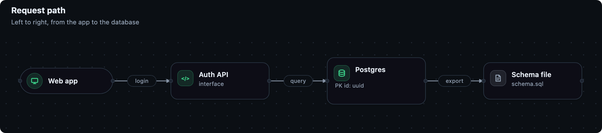
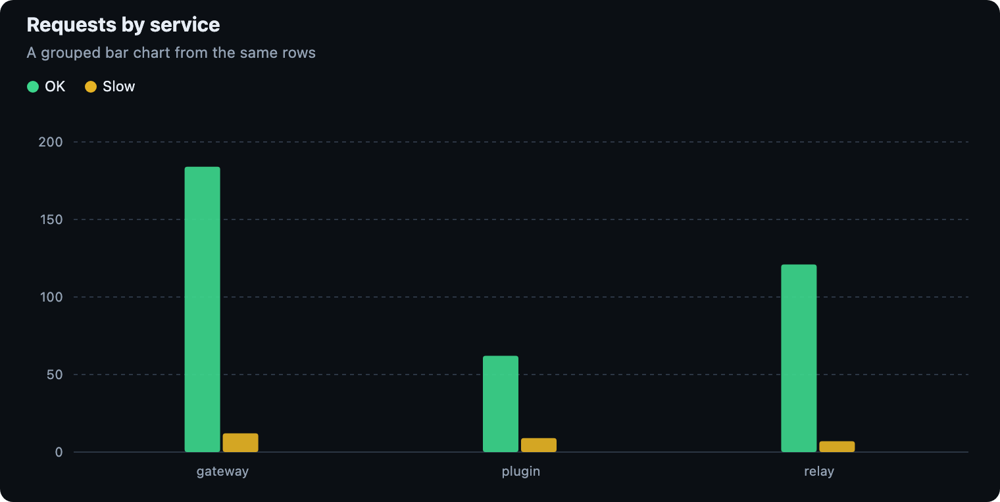

# paseo-plugin-graph-tables

A [Paseo](https://paseo.sh) plugin that brings [Beluga](https://github.com/beluga-labs/beluga)-style interactive tables, charts, KPI stat tiles, timelines, heatmaps, calendars, and auto-layout architecture diagrams into Paseo agent timelines and workspace panels.

> **Attribution**: This plugin adapts and re-implements Beluga's (`https://github.com/beluga-labs/beluga`) `view` and `graph` UX workflows inside Paseo's plugin subprocess (`index.server.ts`) and cross-platform React Native client runtime (`index.client.tsx`).





## Install

```bash
paseo plugin install github:zminds/paseo-plugin-graph-tables
```

Or install a local checkout:

```bash
git clone https://github.com/zminds/paseo-plugin-graph-tables.git
cd paseo-plugin-graph-tables
npm install
npm run typecheck
paseo plugin install "$(pwd)"
```

## Features

- **Agent prompt & `show_view` tool injection** via `agent.open.before` (`index.server.ts`).
- **Daemon-side view store & query engine** (`server/`) supporting:
  - 7 data sources: `file` and `folder` (opt-in), `sqlite` (one read-only SQL statement, no sqlite3 client commands), `postgres` (opt-in via `.env`), `http` (opt-in), `command` (opt-in), and `script` (opt-in). A `show_view` row preview is returned to the agent and its model provider.
  - Interactive `controls`: `buttons`, `select`, `number`, `toggle`, `search`, with safe `{{id}}` parameter interpolation.
  - `views.query`, `views.list`, and `views.export` RPCs for sorting, filtering, searching, pagination, live refresh, and host file export (`~/.paseo-exports`, `~/Downloads/paseo-exports`, or `~/Desktop`).
- **Cross-platform timeline transformer & renderers** (`client/`):
  - Splits `assistant_message` replies containing ```` ```paseo-view ````, ```` ```beluga-view ````, ```` ```paseo-graph ````, ```` ```beluga-graph ````, `<<paseo-view:...>>` tokens, or multi-row GFM Markdown tables into interactive cards while preserving host `<Markdown>` and `<StreamedText>` for surrounding prose.
  - Supports `table` (sortable, searchable, paginated, typed cells, inline accordion row details, `CSV` / `MD` copy, `Save .md`, 1-click Table ↔ Chart switch), `chart` (`bar`, `line`, `area` including stacked area, `pie`, `donut`, `scatter` with type switcher, hover readouts, `Copy SVG`, `Save SVG`, `Save PNG`), `stats`, `graph` (layered DAG layout, draggable nodes & group containers, SmoothStep routing, animated data-flow, step walkthrough, `SVG`/`PNG` export), `gantt`, `heatmap`, `calendar`, `colors`, `code`, and fullscreen `<Modal>` / screen expansion.
  - Strictly isolates web SVG/canvas logic in `client/web.ts` (`Platform.OS === "web"`) with React Native fallbacks on iOS/Android and daemon-side `qlmanage` / `rsvg-convert` / `magick` PNG fallback.
- **Workspace Panel & Settings**:
  - **Views** workspace/explorer panel (`/views` or Command Center) includes both **Live Views** and a **Demo Gallery** to test all chart types, data interactions, and exports anytime.
  - **Settings → Graph & Tables** to toggle prompt/tool injection, Markdown table auto-upgrade, query limits, opt-in data sources, and export directory (`~/Downloads/paseo-exports`, `~/Desktop`, or workspace).
- **Portable `SKILL.md`** included in the repository for ACP agents that do not receive `appendSystemPrompt`.

## Development

```bash
npm install
npm run typecheck
npm test
paseo plugin reload agent-graph-tables
```

Plugin ID is `agent-graph-tables` so selective `paseo-view` / `paseo-graph` / `show_view` transformers evaluate before `better-paseo` while passing all unmatched messages through.
