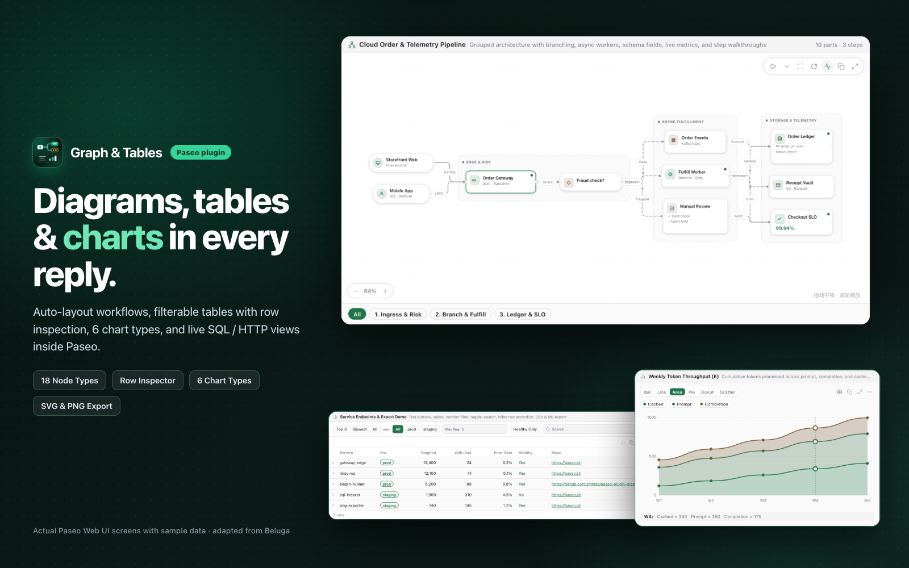
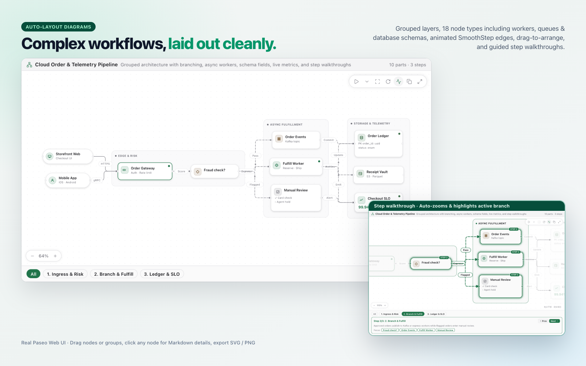
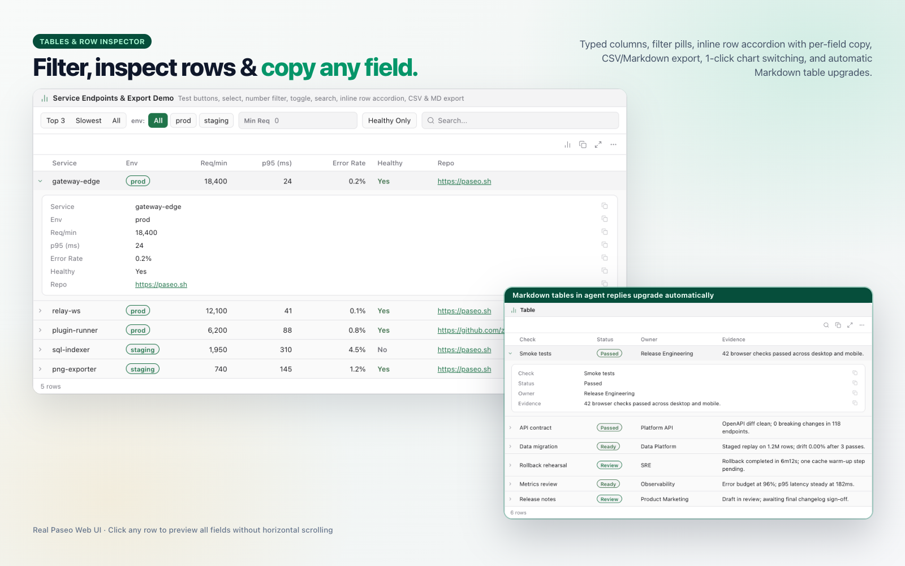
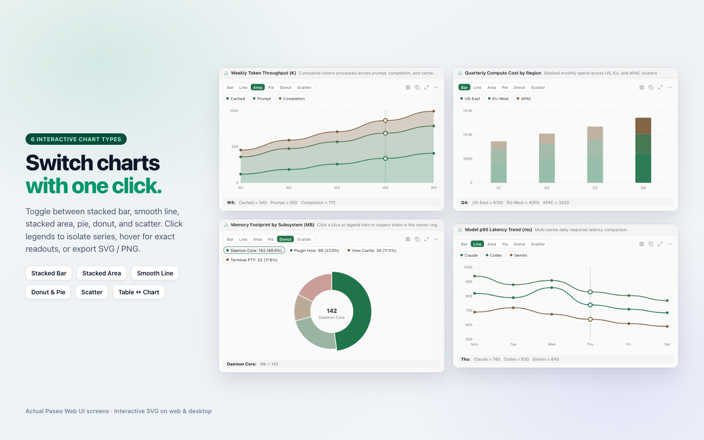
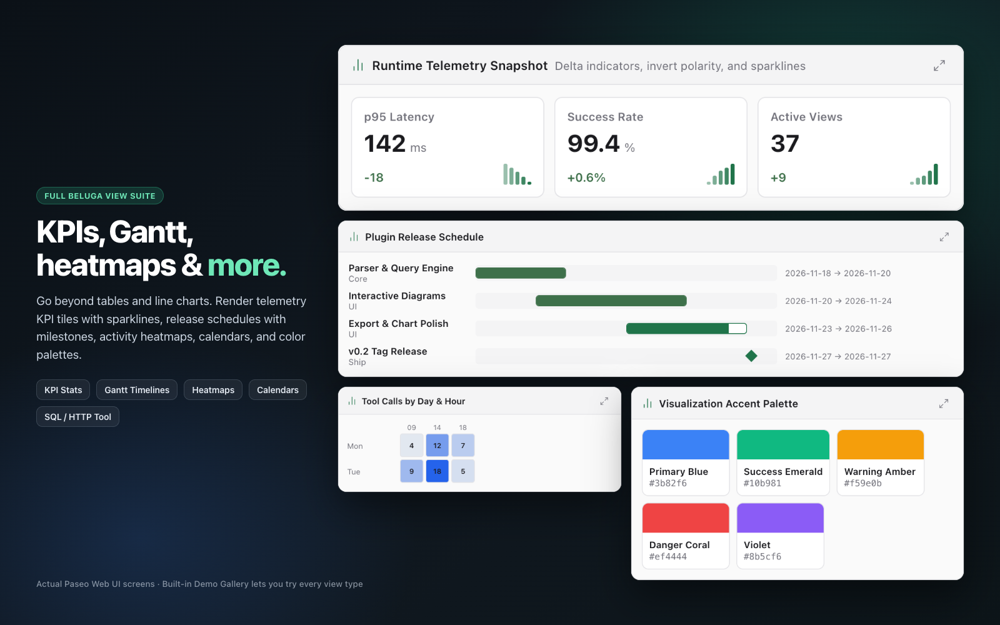
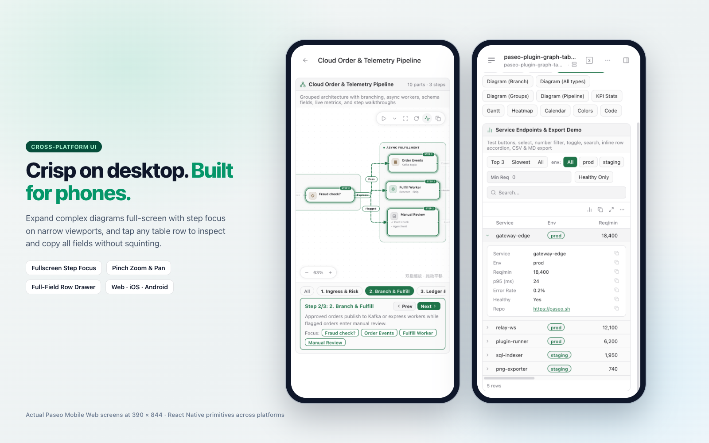

# paseo-plugin-graph-tables

A [Paseo](https://paseo.sh) plugin that brings [Beluga](https://github.com/beluga-labs/beluga)-style interactive tables, charts, KPI stat tiles, timelines, heatmaps, calendars, and auto-layout architecture diagrams into Paseo agent timelines and workspace panels.

中文简介：面向 [Paseo](https://paseo.sh) 的可视化插件（适配自 [Beluga](https://github.com/beluga-labs/beluga)），在智能体对话时间线和工作区面板中自动渲染自动布局复杂流程图、可筛选交互表格与单行预览、6 种图表、KPI 指标卡、甘特图、热力图与活跃度日历。完整的英文与简体中文商店介绍分别位于 [OVERVIEW.md](OVERVIEW.md) 和 [OVERVIEW.zh-CN.md](OVERVIEW.zh-CN.md)。

> **Attribution**: This plugin adapts and re-implements Beluga's (`https://github.com/beluga-labs/beluga`) `view` and `graph` UX workflows inside Paseo's plugin subprocess (`index.server.ts`) and cross-platform React Native client runtime (`index.client.tsx`).

> **Important / 重要说明：通过 Skills 自动渲染，请勿禁用 Skills**
>
> - **English**: Automatic rendering of diagrams, charts, and data views relies on the synced `paseo-graph-tables` skill (`~/.agents/skills`, `~/.claude/skills`, `~/.gemini/config/skills`). **Do not disable skills** in **Settings → Graph & Tables** (`Install global agent SKILL.md`) or in your agent/provider configuration (Codex, Claude Code, Gemini CLI, Pi, ACP providers), otherwise agents will not emit the visualization blocks automatically.
> - **中文**：对话回复中的流程图、图表和交互视图依赖插件自动同步的 `paseo-graph-tables` 技能（同步至 `~/.agents/skills`、`~/.claude/skills`、`~/.gemini/config/skills`）触发自动渲染。**请勿禁用 Skills**：请在 **设置 → Graph & Tables** 保持 `Install global agent SKILL.md` 开启，且不要在 Codex、Claude Code、Gemini CLI、Pi 或 ACP Provider 设置中关闭 Skills 功能或停用 `paseo-graph-tables`，否则智能体不会自动输出可视化视图。



## Install

Install the reviewed listing from the Paseo plugin registry:

```bash
paseo plugin add zminds/graph-tables
```

Or install directly from GitHub:

```bash
paseo plugin install github:zminds/paseo-plugin-graph-tables
```

Or install a local checkout:

```bash
git clone https://github.com/zminds/paseo-plugin-graph-tables.git
cd paseo-plugin-graph-tables
npm install
npm run typecheck
paseo plugin install "$(pwd)"
```

## Showcase

All screenshots below are captured from Paseo Web UI using sample data. Open **Views → Demo Gallery** inside any workspace to try every built-in example.

### Complex workflows and guided walkthroughs

Auto-layout DAG diagrams support grouped layers, 18 node types (including `worker`, `queue`, `database` fields, `decision` branches, `task` checklists, and `metric` values), animated SmoothStep edges, drag-to-arrange, step walkthroughs, and SVG/PNG export.



### Interactive tables, row previews, and Markdown upgrades

Typed service tables support button presets, selects, number filters, toggles, search, CSV/Markdown export, and one-click chart switching. Click any row to open an inline accordion with all fields and per-field copy actions. Multi-row Markdown tables emitted in agent replies upgrade into interactive cards automatically.



### Six chart types with interactive readouts

Switch between stacked bar, smooth line, stacked area, pie, donut, and scatter charts with one click. Toggle legend items to isolate series, hover or click marks for exact readouts, and export SVG or PNG.



### KPI stats, Gantt schedules, heatmaps, and color palettes

Render telemetry KPI cards with sparklines and polarity deltas, project release Gantt timelines with milestones, activity heatmaps, calendars, and copyable color swatches.



### Desktop and Mobile Web

On phones and narrow viewports, diagrams open full-screen with step focus and vertical layout toggling, while tables expand full-field row drawers for comfortable inspection.



### Raw view gallery

Select a screenshot to inspect individual raw desktop (1440 × 1060) and mobile (390 × 844) captures. The six chart examples show the readout after selecting a data point or slice.

| View | Desktop Web | Mobile Web |
| --- | --- | --- |
| Stacked bar | [Desktop](assets/screenshots/desktop/bar.webp) | [Mobile](assets/screenshots/mobile/bar.webp) |
| Smooth line | [Desktop](assets/screenshots/desktop/line.webp) | [Mobile](assets/screenshots/mobile/line.webp) |
| Stacked area | [Desktop](assets/screenshots/desktop/area.webp) | [Mobile](assets/screenshots/mobile/area.webp) |
| Pie | [Desktop](assets/screenshots/desktop/pie.webp) | [Mobile](assets/screenshots/mobile/pie.webp) |
| Donut | [Desktop](assets/screenshots/desktop/donut.webp) | [Mobile](assets/screenshots/mobile/donut.webp) |
| Scatter | [Desktop](assets/screenshots/desktop/scatter.webp) | [Mobile](assets/screenshots/mobile/scatter.webp) |
| KPI stats | [Desktop](assets/screenshots/desktop/stats.webp) | [Mobile](assets/screenshots/mobile/stats.webp) |
| Gantt | [Desktop](assets/screenshots/desktop/gantt.webp) | [Mobile](assets/screenshots/mobile/gantt.webp) · [Scroll to dates](assets/screenshots/mobile/gantt-dates.webp) |
| Heatmap | [Desktop](assets/screenshots/desktop/heatmap.webp) | [Mobile](assets/screenshots/mobile/heatmap.webp) |
| Calendar activity | [Desktop](assets/screenshots/desktop/calendar.webp) | [Mobile](assets/screenshots/mobile/calendar.webp) |
| Color swatches | [Desktop](assets/screenshots/desktop/colors.webp) | [Mobile](assets/screenshots/mobile/colors.webp) |
| Code | [Desktop](assets/screenshots/desktop/code.webp) | [Mobile](assets/screenshots/mobile/code.webp) |
| Branch diagram | [Desktop](assets/screenshots/desktop/graph-branch.webp) | [Mobile](assets/screenshots/mobile/graph-branch.webp) |
| Diagram node types | [Desktop](assets/screenshots/desktop/graph-types.webp) | [Mobile](assets/screenshots/mobile/graph-types.webp) |
| Grouped diagram | [Desktop](assets/screenshots/desktop/graph-groups.webp) | [Mobile](assets/screenshots/mobile/graph-groups.webp) |
| Order workflow | [Desktop](assets/screenshots/desktop/workflow.webp) | [Mobile](assets/screenshots/mobile/workflow.webp) |
| Stock reservation walkthrough | [Desktop](assets/screenshots/desktop/workflow-guided.webp) | [Mobile](assets/screenshots/mobile/workflow-guided.webp) |
| Typed service table | [Desktop](assets/screenshots/desktop/table.webp) | [Mobile](assets/screenshots/mobile/table.webp) |
| Typed row preview | [Desktop](assets/screenshots/desktop/table-row-preview.webp) | [Mobile](assets/screenshots/mobile/table-row-preview.webp) |
| Markdown table | [Desktop](assets/screenshots/desktop/markdown-table.webp) | [Mobile](assets/screenshots/mobile/markdown-table.webp) |
| Markdown row preview | [Desktop](assets/screenshots/desktop/markdown-row-preview.webp) | [Mobile](assets/screenshots/mobile/markdown-row-preview.webp) |

## Features

- **Agent prompt & `show_view` tool injection** via `agent.open.before` (`index.server.ts`).
- **Daemon-side view cache & query engine** (`server/`). Tool-backed views stay in memory until evicted or the plugin reloads or stops.
  - 7 data sources: `file` and `folder` (opt-in), `sqlite` (one read-only SQL statement, no sqlite3 client commands), `postgres` (opt-in via `.env`), `http` (opt-in), `command` (opt-in), and `script` (opt-in). A `show_view` row preview is returned to the agent and its model provider.
  - Interactive `controls`: `buttons`, `select`, `number`, `toggle`, `search`, with safe `{{id}}` parameter interpolation.
  - `views.query`, `views.list`, and `views.export` RPCs for sorting, filtering, searching, pagination, live refresh, and host file export (`~/.paseo-exports`, `~/Downloads/paseo-exports`, or `~/Desktop`).
- **Cross-platform timeline transformer & renderers** (`client/`):
  - Splits `assistant_message` replies containing ```` ```paseo-view ````, ```` ```beluga-view ````, ```` ```paseo-graph ````, ```` ```beluga-graph ````, `<<paseo-view:...>>` tokens, or multi-row GFM Markdown tables into interactive cards while preserving host `<Markdown>` and `<StreamedText>` for surrounding prose.
  - Supports `table` (sortable, searchable, paginated, typed cells, inline accordion row details, `CSV` / `MD` copy, `Save .md`, 1-click Table ↔ Chart switch), `chart` (`bar`, `line`, `area` including stacked area, `pie`, `donut`, `scatter` with type switcher, hover readouts, `Copy SVG`, `Save SVG`, `Save PNG`), `stats`, `graph` (layered DAG layout, draggable nodes & group containers, SmoothStep routing, animated data-flow, step walkthrough, `SVG`/`PNG` export), `gantt`, `heatmap`, `calendar`, `colors`, `code`, and fullscreen `<Modal>` / screen expansion.
  - Strictly isolates web SVG/canvas logic in `client/web.ts` (`Platform.OS === "web"`) with React Native fallbacks on iOS/Android and daemon-side `qlmanage` / `rsvg-convert` / `magick` PNG fallback.
- **Workspace Panel & Settings**:
  - **Views** workspace/explorer panel (`/views` or Command Center) includes both **Live Views** and a **Demo Gallery** to test all chart types, data interactions, and exports anytime.
  - **Settings → Graph & Tables** to toggle prompt/tool injection, Markdown table auto-upgrade, query limits, opt-in data sources, and export directory (`~/Downloads/paseo-exports`, `~/Desktop`, or workspace).
- **Portable `SKILL.md`** included in the repository for ACP agents that do not receive `appendSystemPrompt`.

## Development

```bash
npm install
npm run typecheck
npm test
paseo plugin reload agent-graph-tables
```

Plugin ID is `agent-graph-tables` so selective `paseo-view` / `paseo-graph` / `show_view` transformers evaluate before `better-paseo` while passing all unmatched messages through.
