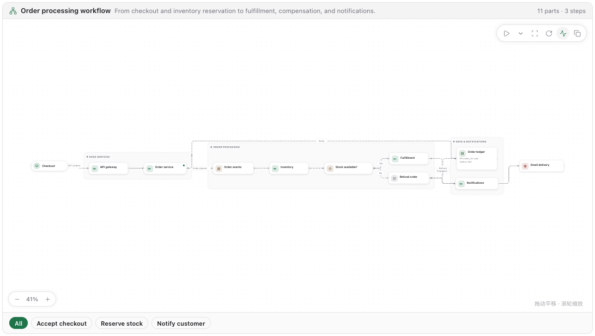
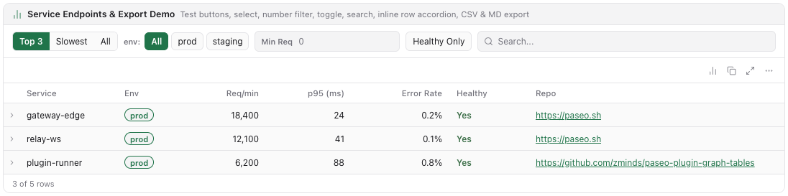
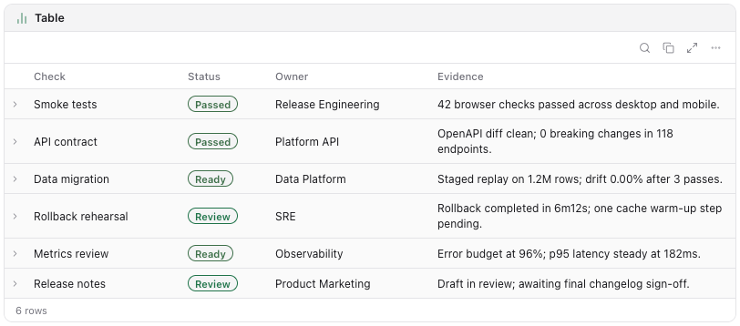
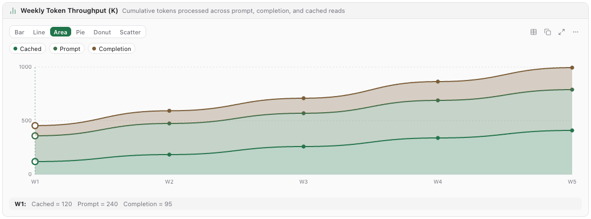
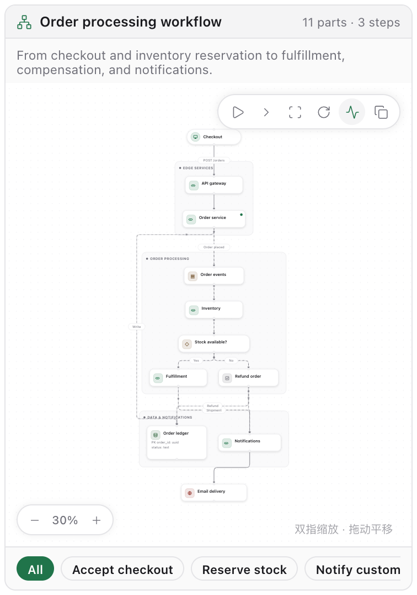
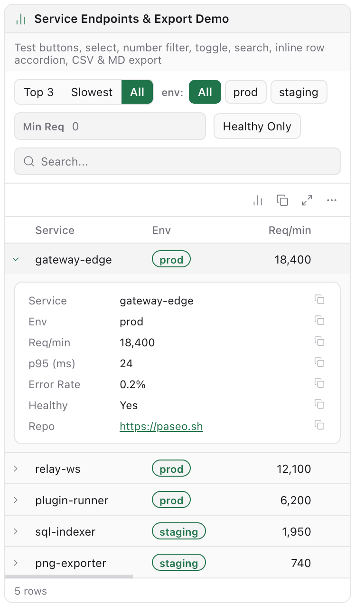

# paseo-plugin-graph-tables

A [Paseo](https://paseo.sh) plugin that brings [Beluga](https://github.com/beluga-labs/beluga)-style interactive tables, charts, KPI stat tiles, timelines, heatmaps, calendars, and auto-layout architecture diagrams into Paseo agent timelines and workspace panels.

> **Attribution**: This plugin adapts and re-implements Beluga's (`https://github.com/beluga-labs/beluga`) `view` and `graph` UX workflows inside Paseo's plugin subprocess (`index.server.ts`) and cross-platform React Native client runtime (`index.client.tsx`).



The workflow connects checkout, inventory, fulfillment, and notifications. [Stock reservation walkthrough](assets/screenshots/desktop/workflow-guided.webp)

## Install

```bash
paseo plugin install github:zminds/paseo-plugin-graph-tables
```

Or install a local checkout:

```bash
git clone https://github.com/zminds/paseo-plugin-graph-tables.git
cd paseo-plugin-graph-tables
npm install
npm run typecheck
paseo plugin install "$(pwd)"
```

## Screenshots

These screenshots use sample data in Paseo Web at 1440 × 1060 and 390 × 844. Open **Views → Demo Gallery** to try the built-in examples.

### Filterable tables and Markdown tables

The service table shows the three busiest endpoints with environment badges, formatted metrics, and links.



The release checklist was emitted as a Markdown table in an agent reply. Select a row to see all its fields and copy values individually. [Expanded release checklist row](assets/screenshots/desktop/markdown-row-preview.webp)



### Chart readouts

Hover over or select a chart mark to see its values. On multi-series charts, use the legend to hide or restore a series.



### Mobile Web

The same workflow can be laid out top to bottom. The row preview fits all fields in the viewport while the table columns scroll horizontally.

<p>
  <a href="assets/screenshots/mobile/workflow.webp"></a>
  <a href="assets/screenshots/mobile/table-row-preview.webp"></a>
</p>

### View gallery

Select a screenshot to inspect the view at its captured size. The six chart examples show the readout after selecting a data point or slice.

| View | Desktop Web | Mobile Web |
| --- | --- | --- |
| Stacked bar | [Desktop](assets/screenshots/desktop/bar.webp) | [Mobile](assets/screenshots/mobile/bar.webp) |
| Smooth line | [Desktop](assets/screenshots/desktop/line.webp) | [Mobile](assets/screenshots/mobile/line.webp) |
| Stacked area | [Desktop](assets/screenshots/desktop/area.webp) | [Mobile](assets/screenshots/mobile/area.webp) |
| Pie | [Desktop](assets/screenshots/desktop/pie.webp) | [Mobile](assets/screenshots/mobile/pie.webp) |
| Donut | [Desktop](assets/screenshots/desktop/donut.webp) | [Mobile](assets/screenshots/mobile/donut.webp) |
| Scatter | [Desktop](assets/screenshots/desktop/scatter.webp) | [Mobile](assets/screenshots/mobile/scatter.webp) |
| KPI stats | [Desktop](assets/screenshots/desktop/stats.webp) | [Mobile](assets/screenshots/mobile/stats.webp) |
| Gantt | [Desktop](assets/screenshots/desktop/gantt.webp) | [Mobile](assets/screenshots/mobile/gantt.webp) · [Scroll to dates](assets/screenshots/mobile/gantt-dates.webp) |
| Heatmap | [Desktop](assets/screenshots/desktop/heatmap.webp) | [Mobile](assets/screenshots/mobile/heatmap.webp) |
| Calendar activity | [Desktop](assets/screenshots/desktop/calendar.webp) | [Mobile](assets/screenshots/mobile/calendar.webp) |
| Color swatches | [Desktop](assets/screenshots/desktop/colors.webp) | [Mobile](assets/screenshots/mobile/colors.webp) |
| Code | [Desktop](assets/screenshots/desktop/code.webp) | [Mobile](assets/screenshots/mobile/code.webp) |
| Branch diagram | [Desktop](assets/screenshots/desktop/graph-branch.webp) | [Mobile](assets/screenshots/mobile/graph-branch.webp) |
| Diagram node types | [Desktop](assets/screenshots/desktop/graph-types.webp) | [Mobile](assets/screenshots/mobile/graph-types.webp) |
| Grouped diagram | [Desktop](assets/screenshots/desktop/graph-groups.webp) | [Mobile](assets/screenshots/mobile/graph-groups.webp) |
| Order workflow | [Desktop](assets/screenshots/desktop/workflow.webp) | [Mobile](assets/screenshots/mobile/workflow.webp) |
| Stock reservation walkthrough | [Desktop](assets/screenshots/desktop/workflow-guided.webp) | [Mobile](assets/screenshots/mobile/workflow-guided.webp) |
| Typed service table | [Desktop](assets/screenshots/desktop/table.webp) | [Mobile](assets/screenshots/mobile/table.webp) |
| Typed row preview | [Desktop](assets/screenshots/desktop/table-row-preview.webp) | [Mobile](assets/screenshots/mobile/table-row-preview.webp) |
| Markdown table | [Desktop](assets/screenshots/desktop/markdown-table.webp) | [Mobile](assets/screenshots/mobile/markdown-table.webp) |
| Markdown row preview | [Desktop](assets/screenshots/desktop/markdown-row-preview.webp) | [Mobile](assets/screenshots/mobile/markdown-row-preview.webp) |

## Features

- **Agent prompt & `show_view` tool injection** via `agent.open.before` (`index.server.ts`).
- **Daemon-side view cache & query engine** (`server/`). Tool-backed views stay in memory until evicted or the plugin reloads or stops.
  - 7 data sources: `file` and `folder` (opt-in), `sqlite` (one read-only SQL statement, no sqlite3 client commands), `postgres` (opt-in via `.env`), `http` (opt-in), `command` (opt-in), and `script` (opt-in). A `show_view` row preview is returned to the agent and its model provider.
  - Interactive `controls`: `buttons`, `select`, `number`, `toggle`, `search`, with safe `{{id}}` parameter interpolation.
  - `views.query`, `views.list`, and `views.export` RPCs for sorting, filtering, searching, pagination, live refresh, and host file export (`~/.paseo-exports`, `~/Downloads/paseo-exports`, or `~/Desktop`).
- **Cross-platform timeline transformer & renderers** (`client/`):
  - Splits `assistant_message` replies containing ```` ```paseo-view ````, ```` ```beluga-view ````, ```` ```paseo-graph ````, ```` ```beluga-graph ````, `<<paseo-view:...>>` tokens, or multi-row GFM Markdown tables into interactive cards while preserving host `<Markdown>` and `<StreamedText>` for surrounding prose.
  - Supports `table` (sortable, searchable, paginated, typed cells, inline accordion row details, `CSV` / `MD` copy, `Save .md`, 1-click Table ↔ Chart switch), `chart` (`bar`, `line`, `area` including stacked area, `pie`, `donut`, `scatter` with type switcher, hover readouts, `Copy SVG`, `Save SVG`, `Save PNG`), `stats`, `graph` (layered DAG layout, draggable nodes & group containers, SmoothStep routing, animated data-flow, step walkthrough, `SVG`/`PNG` export), `gantt`, `heatmap`, `calendar`, `colors`, `code`, and fullscreen `<Modal>` / screen expansion.
  - Strictly isolates web SVG/canvas logic in `client/web.ts` (`Platform.OS === "web"`) with React Native fallbacks on iOS/Android and daemon-side `qlmanage` / `rsvg-convert` / `magick` PNG fallback.
- **Workspace Panel & Settings**:
  - **Views** workspace/explorer panel (`/views` or Command Center) includes both **Live Views** and a **Demo Gallery** to test all chart types, data interactions, and exports anytime.
  - **Settings → Graph & Tables** to toggle prompt/tool injection, Markdown table auto-upgrade, query limits, opt-in data sources, and export directory (`~/Downloads/paseo-exports`, `~/Desktop`, or workspace).
- **Portable `SKILL.md`** included in the repository for ACP agents that do not receive `appendSystemPrompt`.

## Development

```bash
npm install
npm run typecheck
npm test
paseo plugin reload agent-graph-tables
```

Plugin ID is `agent-graph-tables` so selective `paseo-view` / `paseo-graph` / `show_view` transformers evaluate before `better-paseo` while passing all unmatched messages through.
